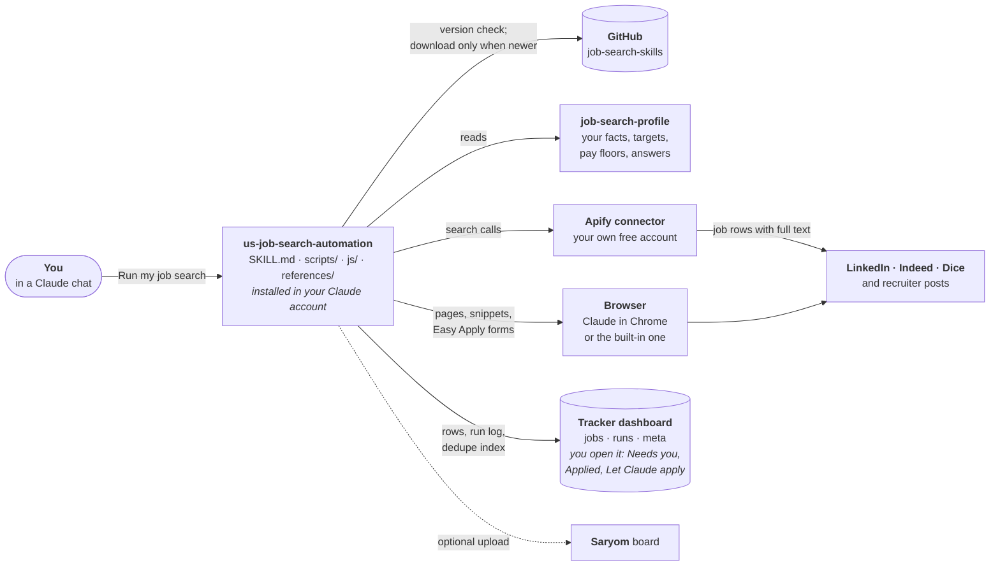
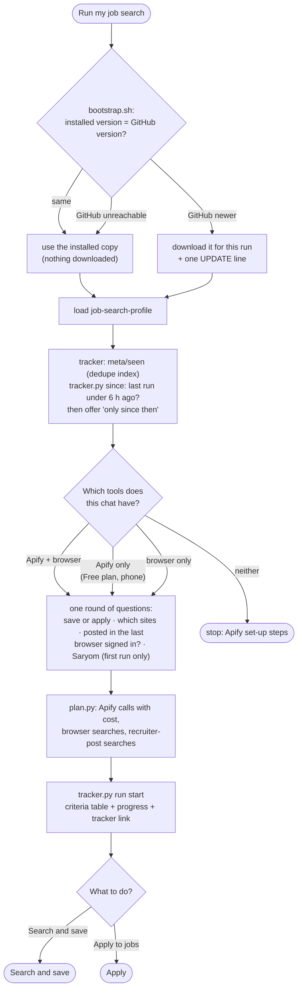
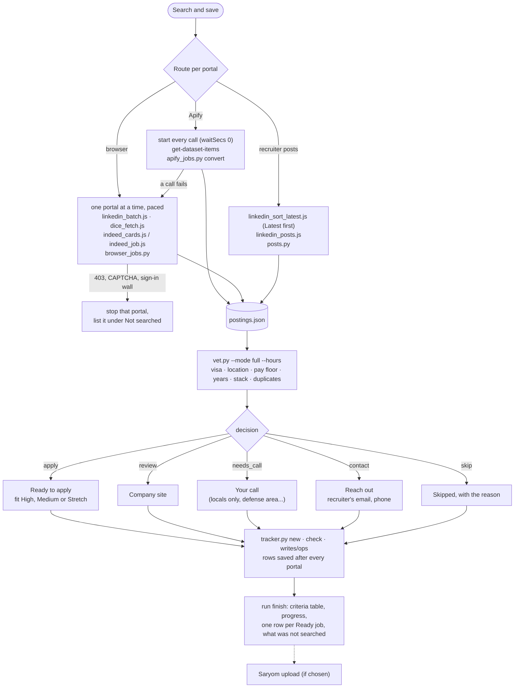
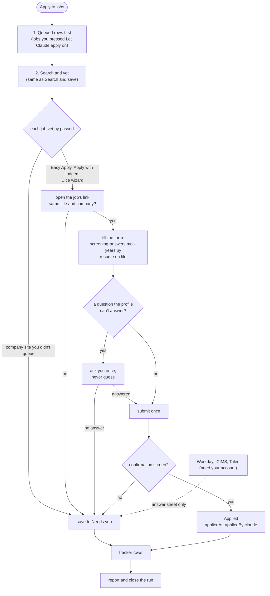

# job-search-skills

Two Claude skills that run a US job search for you. Claude finds fresh postings on LinkedIn, Indeed and Dice, vets each one against your profile (work authorization, location, pay, seniority, stack), then either saves the good ones for you or applies through Easy Apply and similar one-page forms, your choice each run. It keeps a live tracker dashboard that shows each run's progress and each job's details, and can send your applications to your board on Saryom.

**New in 2.1:** runs never stop on "GitHub not reachable", every question (including whether your browser is signed in) is asked once before anything opens, runs use far fewer tokens, and the dashboard filters by fit, sponsorship, source, posting age and Easy Apply.

**New in 2.0:** searches run through your own free [Apify](https://apify.com) account when you connect it, so a search needs no browser, works on Claude Free and on a phone, and no longer trips the portals' bot checks. The browser is still what applies. It also searches LinkedIn recruiter posts by your keywords and saves each recruiter's contact details so you can reach out yourself. Company-site applications wait for your go-ahead.

| Skill | What it is | Updates |
|---|---|---|
| `skills/us-job-search-automation` | The workflow, plus scripts, Apify calls, browser snippets, reference guides, tests and an empty tracker | Each run checks this repo's version first (a few bytes). Already the latest: it runs your installed copy, nothing downloaded. Newer here: that run downloads and uses it, and tells you once to reinstall the zip. GitHub unreachable: it runs your installed copy. |
| `skills/job-search-profile` | A blank profile: contact details, visa status, targets, locations, pay floors, form answers | Never updated from here; it's yours |

Nothing personal lives in this repo. Your profile and your tracker stay in your own Claude account.

## What you need

| You have | Search and save | Apply for you | Recruiter posts |
|---|---|---|---|
| Apify connector **and** Claude in Chrome (paid Claude plans) | Yes, through Apify | Yes | Yes |
| Apify connector only (**Claude Free**, or your phone) | Yes, through Apify | No: you apply from the dashboard | No |
| Claude in Chrome only | Yes, in the browser (slower, and portals sometimes block it) | Yes | Yes |

Every set-up needs a Claude plan with skills, code execution and artifacts, which includes Free.

## How it works

Four pictures: what talks to what, how every run starts, and the two paths a run can take after that (search and save, or apply). Each box names the file that does the work, so you can open it in `skills/us-job-search-automation/`.

### The pieces



### Every run starts the same way (step 0)

Nothing opens in a browser until this is done, and every question is asked once, here.



### Search and save

Nothing is submitted. Good matches wait in the dashboard's **Needs you** with their full text, until you apply yourself or press **Let Claude apply**.



### Apply

Needs a browser. Claude submits only one-page forms it can fill from your profile, and marks a job **Applied** only after the site's confirmation screen.



What it never does, in any mode: type passwords, create accounts, solve CAPTCHAs, contact recruiters, or go around a site that blocked it.

## Install

1. Download [`dist/us-job-search-automation.zip`](dist/us-job-search-automation.zip) and [`dist/job-search-profile.zip`](dist/job-search-profile.zip).
2. In Claude, open Customize > Skills and upload both zips as they are.
3. **Apify (recommended, free).** Sign up at [apify.com](https://apify.com) with your own account and **do not add a payment card**: without one, Apify stops at the free $5 a month and can never bill you. In Claude, open Customize > Connectors > Add custom connector, enter `https://mcp.apify.com`, press Connect and sign in to Apify. Claude Free allows one custom connector; use it for this. A run costs about 6 cents of the free $5.
4. **Browser (to apply, paid Claude plans).** Install the Claude in Chrome extension, allow linkedin.com, indeed.com and dice.com in it, and sign in to the three portals in that Chrome with your current resume uploaded to each.
5. New chat: attach your resume and say **"Set up my job-search profile from my resume."** Save the profile Claude proposes.
6. Then say **"Run my job search."** The first run creates your tracker. Every prompt is listed under [Prompts, step by step](#prompts-step-by-step).

### Updating

You don't have to: every run uses the newest version whenever GitHub is reachable. When your installed copy is behind, the run says so once (`UPDATE: the installed skill is X and the latest is Y`). To catch up, download [`dist/us-job-search-automation.zip`](dist/us-job-search-automation.zip) again and upload it in Customize > Skills, replacing the old one; later runs then start without a download and also work when GitHub is blocked. Your profile skill is never replaced, so your details stay.

**Installed an earlier short "stub" version** (its Version line says "stub")? Replace it with the zip above once: the stub has no scripts, so it must download every run and stops when GitHub is unreachable.

Never share an Apify account or token with a friend: each person signs up for their own, so each gets their own free $5.

## Prompts, step by step

Say these in a Claude chat. The words in bold are what matter; the rest can be your own.

**1. Once: set up.** Attach your resume.
> **Set up my job-search profile from my resume.**

Claude fills the profile from the resume, asks what the resume cannot say (work authorization, locations, pay floors, target titles), and proposes the profile. Save it.

**2. Every time: run the search.**
> **Run my job search.**

Before it searches, Claude asks what it doesn't already know, in one go:

| Question | Choices |
|---|---|
| What to do | **Search and save to the dashboard** (nothing is submitted) or **Apply to jobs** (Easy Apply, Apply with Indeed, Dice; needs the browser) |
| Which sites | LinkedIn, Indeed, Dice, LinkedIn recruiter posts (pick any) |
| Posted in the last | 12 hours, 24 hours, 2 days, 3 days |

When the run will use a browser (a site Apify doesn't cover, recruiter posts, or applying), the same round asks whether that browser is signed in to those sites. Say yes only if it is: Claude then opens no test pages, and a site that turns out to be signed out is skipped with its links rather than retried. The first run also asks whether to send your jobs to Saryom.

To skip the questions, say it all at once:
> **Search and save jobs from the last 24 hours.**
> **Run my job search and apply to the good fits, last 2 days, and send it to Saryom.**

**3. While it runs: watch the progress.** Claude posts the same list after every stage, and the dashboard shows it live at the top of Overview:
```
Run 2026-11-12-1 · apply · jobs 48h, posts 12h · 3 of 9 stages
✔ Set-up: profile loaded, 58 rows known
✔ Queued jobs: 2 applied
✔ LinkedIn (Apify): 25 read, 4 to apply, 2 for you
▶ Indeed (Apify)
○ Dice (Apify)
○ Recruiter posts
○ Apply
○ Saryom
○ Report
```
✔ done · ▶ in progress · ○ waiting · – skipped, with the reason.

**4. After a search-and-save run: decide on the dashboard.** Open **Needs you**. Each *Ready to apply* job shows **About this job** (the posting's text, when it was posted, Easy Apply or company site) and has **Open to apply**, **Let Claude apply**, **I applied** and **Not interested**; one button queues them all. Without a browser for Claude, open the job, apply yourself and press **I applied**. With one:
> **Apply to the ones I queued.**
> **Apply to the saved ones.** (queues every Ready to apply job, then applies)

**5. Company-site jobs.** These wait under Needs you. Press **Let Claude apply** there, or say:
> **Apply to the company-site ones too.**

Sites that need an account (Workday, iCIMS, Taleo) stay with you; ask for **an answer sheet for the Workday ones**.

**6. Recruiter posts.**
> **Search recruiter posts for Java AND (C2C OR W2), last 24 hours.**

Matches appear under **Reach out** with the recruiter's name, email and phone. You contact them; then press **I reached out**. For help with the message: **Draft an email to the recruiter at <company>.**

**7. Follow-ups and replies.** Set the stage (Screening, Interview, Offer...) on the dashboard's Applied view when you hear back, or say:
> **What follow-ups are due?**

**8. Saryom** ([saryom.com](https://saryom.com) > Jobs). Optional: your applications on a private board, and the recruiters you found added to a directory shared with other job seekers.
- **With a file:** say **Send my tracker to Saryom as a file.** Claude gives you `saryom-upload.json`; on Saryom open Jobs > My applications > **Bring in from the skill** and choose the file.
- **With a token:** in that same dialog press **Create a token**, copy it, and say **Send my tracker to Saryom**; paste the token when Claude asks. A token can only add jobs, cannot read your board, and you can revoke it there.
- To stop being asked each run, let Claude save your answer in your profile, or say **Don't send to Saryom.**

Sending again updates your board; it never duplicates a job, moves one backwards or touches notes you wrote there.

**9. Change what it looks for.**
> **Add Texas to my on-site states.** · **Lower my W2 floor to $60 an hour.** · **Add "Backend Engineer" to my target titles.**

The dashboard's **What if** view shows which rule skipped the most good matches.

**10. Schedule it.** A search-and-save run through Apify needs no browser; an apply run needs a signed-in browser Claude can reach at that time.
> **Run my job search every weekday at 8am: search and save, last 24 hours.**

## Updates

The automation skill fetches this repo at the start of every run (`bootstrap.sh`) and follows whatever is on `main`: scripts, snippets, references, the tracker template and the instructions themselves. A fix or a new version applies on your next run with nothing to install. When the tracker template is newer than your dashboard, Claude offers to refresh it; your rows are untouched.

**If GitHub can't be reached** the run doesn't stop. `bootstrap.sh` tries git, then three tarball downloads, then a copy from earlier in the session, then the copy you installed, and says in one line which one it used. To get updates again, allow `github.com` and `codeload.github.com` in Claude's code-execution network settings. This only works if you installed the full zip from `dist/` (it carries every script). A hand-made skill that only says "clone the repo" has nothing to fall back to: replace it with the zip once.

**Your profile** is never changed by an update. If a release adds a setting, the bundled `profile_defaults.json` fills it in until you set your own value.

## Making a change (maintainer)

1. Edit files under `skills/`.
2. Bump `skills/us-job-search-automation/VERSION` and the `Version:` line in its SKILL.md to the same value.
3. Add an entry to `CHANGELOG.md`. Write **Requires new instructions** when the new scripts need the new SKILL.md.
4. Run `python3 tools/build.py`. It runs the self-test, checks the versions match, and rebuilds the zips in `dist/`.
5. Commit and push. The GitHub Actions check repeats the self-test.

## Layout

```
skills/us-job-search-automation/   SKILL.md, VERSION, scripts/, js/, references/, evals/, assets/
skills/job-search-profile/         SKILL.md (template)
dist/                              zips for installing
tools/build.py                     self-test + version check + zip build
skills/us-job-search-automation/bootstrap.sh   gets the newest tools each run, with fallbacks
```

## Ground rules the skill follows

- Submits only when you ask it to apply in that chat. A search-and-save run submits nothing.
- Sends your jobs to Saryom only when you choose it, and never prints or stores your token unless you ask.
- Uses only your own free Apify account, caps every Apify call at 5 cents, and never stores or prints a token.
- When a portal blocks the browser, it stops and asks you; it never works around a block.
- Never creates accounts, types passwords or solves CAPTCHAs. Workday, iCIMS and Taleo applications stay with you.
- Never emails, calls or messages a recruiter for you. It collects the contact details; the outreach is yours.
- Every answer on a form comes from your profile or resume. If neither covers a question, it asks once or leaves the job for you.
